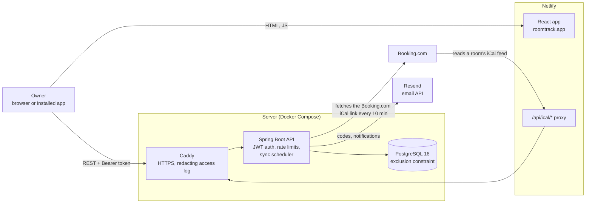

# RoomTrack

**One calendar for every booking of a small guesthouse: the owner's own guests and their Booking.com bookings, kept in sync, so a room is never sold twice.**

- App: [roomtrack.app](https://roomtrack.app) (installable as a phone app)
- Demo: the login and register pages have a **"Try the demo"** button (your own copy of sample data, no sign-up)
- API documentation: [api.roomtrack.app/swagger-ui](https://api.roomtrack.app/swagger-ui/index.html)

Spring Boot 4 · Java 25 · PostgreSQL 16 · Flyway · React 19 · TypeScript · Vite · Tailwind CSS · Docker Compose · Caddy · Netlify

---

## The problem

A family that rents out a few rooms usually sells them in two places: on Booking.com, and directly to guests who call,
write or come back every year. The direct bookings live in a notebook or a spreadsheet; the Booking.com ones live in
the Booking.com extranet. Nothing connects the two, so the same night can be sold twice, and the owner only finds out
when two guests stand at the door.

RoomTrack is a single calendar for both. Direct bookings are entered in RoomTrack and sent to Booking.com through an
iCal link, so Booking.com closes those nights. Booking.com bookings are pulled into RoomTrack through Booking.com's
own iCal link. And the database itself refuses two live bookings of the same room on the same night.

## What it does

- **Properties and rooms** (a property can be created with its rooms in one step).
- **Bookings** with guest, guest count, price per night or per guest, total amount and notes. Statuses `CONFIRMED`,
  `PAID`, `BLOCK` (the owner closes nights, no guest) and `CANCELLED`. A booking can be **moved** to another room of the
  same property or **copied** to several rooms (group bookings). Cancelling is not deleting: cancelled bookings have
  their own searchable list and can be restored.
- **Booking.com sync in both directions** (details [below](#calendar-sync)).
- **Earnings overview** ("Invoices" in the app) per property, room and booking, with filters and an **Excel export**.
  Only `CONFIRMED` and `PAID` bookings count; bookings without an amount are listed so they can be filled in.
- **Email notifications** about imported, changed and cancelled Booking.com bookings, booking conflicts and failing
  syncs, with an on/off switch and one-click unsubscribe.
- **Installable app (PWA)**: works from the home screen; when the connection drops, the last loaded calendar stays
  visible (read-only).
- **Accounts**: sign-up with email verification, forgot password, change password, **download my data** (JSON) and
  **delete my account**, Privacy Policy and Terms pages.

## Preventing double bookings: the exclusion constraint

This is the core of RoomTrack. Every booking stores its stay as a PostgreSQL `daterange`, and one constraint makes
overlapping live bookings of the same room impossible (from
[`V3__reservation.sql`](backend/src/main/resources/db/migration/V3__reservation.sql)):

```sql
CREATE EXTENSION IF NOT EXISTS btree_gist;

ALTER TABLE reservation
    ADD CONSTRAINT no_overlap
    EXCLUDE USING gist (unit_id WITH =, stay_range WITH &&)
    WHERE (status <> 'CANCELLED');
```

Read it as: *no two rows may have the same `unit_id` **and** overlapping (`&&`) stay ranges, unless one of them is
cancelled.*

- **Same-day turnover is allowed.** A stay is the half-open range `[check-in, check-out)`: the check-out day is not a
  booked night. PostgreSQL stores every `daterange` in this form, and the code builds it the same way
  (`Range.closedOpen(checkIn, checkOut)`). A guest leaving on 14 July and the next one arriving on 14 July do not
  overlap.
- **Cancelled bookings free their nights** (`WHERE status <> 'CANCELLED'`). `CONFIRMED`, `PAID` and `BLOCK` all hold
  them, so an owner's closed nights are protected exactly like real bookings.
- **It applies to every source.** Direct bookings and imported Booking.com bookings land in the same table, so the
  rule cannot be skipped by any code path.
- **`btree_gist`** is needed because a GiST index has to compare a plain `uuid` with `=` next to a range with `&&`.

### Why a database constraint, not just a check in the code

The service does check first: before saving, it looks for an overlapping live booking and, if there is one, answers
with the room and dates that are taken. But "check, then insert" has a gap: two requests for the same nights can both
check, find nothing, and both insert. The constraint closes that gap, because PostgreSQL decides atomically. An
integration test fires 8 identical bookings at the same moment and asserts that exactly one succeeds and seven get
`409` (`simultaneousBookingsOfTheSameNightsLetExactlyOneWin`).

### How a refusal reaches the client

Both layers answer `409 Conflict` with the stable code `DATES_TAKEN`:

```json
{ "status": 409, "error": "Conflict", "code": "DATES_TAKEN",
  "message": "Room 2 is already booked on some of these dates.",
  "room": "Room 2", "takenFrom": "2026-07-10", "takenTo": "2026-07-14" }
```

When the check finds the clash, the answer names the colliding booking (above), so the app can say *which* dates
are taken. When the constraint catches a race (`DataIntegrityViolationException` naming `no_overlap`), the answer is
the same code with the message "These dates are no longer available for this room." Moving a booking to another room
goes through the same check.

The Booking.com import never relies on the error: it checks first, and when an incoming booking would overlap, it
does **not** save it and does **not** touch the existing one. Instead it records a *booking conflict*, emails the
owner once, and shows it in the app until the owner dismisses it or Booking.com's feed changes. If a race still makes
the constraint fire during an import, the whole import of that calendar is rolled back and retried on the next run.

## Architecture



- The **frontend** is a static React build on Netlify. It talks to the API at `api.roomtrack.app` with a bearer token.
  Netlify also forwards `roomtrack.app/api/ical/*` to the API, so the feed link given to Booking.com is on the app's
  own domain.
- **Caddy** terminates HTTPS (automatic certificates) and writes an access log in which feed tokens, unsubscribe tokens
  and authorization headers are replaced before they are written.
- The **Spring Boot API** is stateless (no server sessions). It reads the client's IP from Caddy's `X-Forwarded-For`
  only because the connection comes from Caddy (Tomcat's trusted internal proxies), so clients cannot fake it.
- **PostgreSQL** is only reachable on the server itself. The schema is versioned with **Flyway** migrations.

## Calendar sync

**Export (RoomTrack → Booking.com).** Every room has its own feed, `/api/ical/{token}.ics`, with a random 64-character
token. It contains the room's live **direct** bookings (including `BLOCK`ed nights); the summary is the guest's name or
"Reserved", never email or phone. Imported Booking.com bookings are left out, because Booking.com already knows them.
Unknown tokens are rate limited per IP to slow guessing; known feeds are limited per feed.

**Import (Booking.com → RoomTrack).** The owner pastes the Booking.com calendar export link into a room. A scheduler
wakes every minute and syncs the calendars whose last sync is older than 10 minutes, so each calendar is refreshed
about every 10 minutes; the owner can also sync on demand (at most once a minute).

- Events are matched by their iCal `UID` and a SHA-256 hash of the raw event, so unchanged events cost nothing.
- **New** event: saved as a booking with source `BOOKING`, or recorded as a **conflict** if it overlaps.
- **Changed dates**: the booking moves; if the owner had entered an amount, it is flagged *price needs review*.
- **Event gone from the feed**: the booking is cancelled (and restored if it comes back).
- **RoomTrack's own events echoed back** by Booking.com (UIDs ending in `@roomtrack`) are skipped, so a direct booking
  is never imported as a second booking.
- **Closed dates**: the import has no special handling for them. The in-app guide tells owners to choose Booking.com's
  "Booked dates only" export setting, so closed dates are not in the feed.
- **Safety**: only `https` links on `booking.com` are accepted, links that resolve to private or local network
  addresses are refused, downloads time out after 15 seconds and are capped at 5 MB, and three failures in a row
  email the owner once.

Airbnb links are not accepted at the moment (the `AIRBNB` source value is kept for later).

## Security and privacy

- **Passwords** are hashed with BCrypt. Verification and reset codes are stored only as keyed hashes, expire within
  minutes and allow a few attempts.
- **Sessions** are JWTs (HS256) with an idle timeout and an absolute timeout; while the user is active the API returns
  a renewed token in the `X-Refreshed-Token` header. Changing or resetting the password ends every other session (a
  token version in the database). The frontend keeps the token in `localStorage`.
- **Tenant isolation**: every table row carries its owner. The owner id comes only from the verified token, never from
  the request, and every query filters by it. Someone else's id gets the same `404` as an id that does not exist.
  Integration tests check this for properties, rooms, bookings, connected calendars, cancelled bookings, earnings and
  the data export. (Isolation is enforced in the application, not with PostgreSQL row-level security.)
- **No account enumeration**: sign-up, resend-code and forgot-password give the same answer whether or not an address
  is registered; an unknown address costs the same password-hashing work as a wrong password.
- **Rate limits** (in-memory sliding windows, answered with `429` and `Retry-After`), for example:

  | What | Limit |
  |---|---|
  | Wrong passwords per account / per IP | 5 / 20 per 15 minutes (temporary, never a permanent lock) |
  | Sign-up per IP / per email | 5 / 5 per hour |
  | Forgot password per IP | 5 per hour |
  | Change password, delete account | 5 per 15 minutes |
  | Data export | 5 per hour |
  | Calendar feed per feed / unknown feed tokens per IP | 120 / 30 per hour |
  | API documentation per IP | 300 per hour |
  | New demos per IP | 10 per hour |

- **Logs** are kept free of secrets: Caddy's access log replaces tokens and drops authorization headers, unexpected
  errors are logged with the route pattern (`/api/ical/{token}.ics`, not the real address) under an id that the
  client also receives, and PostgreSQL error details with column values are switched off.
- **Privacy**: users can download everything stored about them as JSON (password hashes and calendar links are left
  out, since they work like passwords) and delete their account, which deletes all of its data at once. The email log
  is kept for 90 days, codes for 7 days.

## Try the demo

The login and register pages have a **"Try the demo"** button (`POST /api/auth/demo`). Each click creates a private
account for that visitor with two fictional properties, five rooms and 22 bookings around today's date (past, current
and upcoming stays, a back-to-back turnover, blocked nights, a cancelled booking, a booking without an amount), and
signs them in. All names are invented. Nobody else sees it.

- Visitors can do almost everything, including trying to double-book a room to see the `409`.
- A small "Try it" button opens a checklist of 13 things to try, from creating a booking to attempting a double booking
  (cancel a booking, book the same nights, try to restore it). Instructions stay hidden behind a **Hint** button, so
  visitors first try on their own. Each task ticks itself from the real API answer; progress is kept in the visitor's
  browser.
- A demo is deleted with everything in it 1 hour after it was created (a job checks every 5 minutes).
- Turned off in a demo, on the server (`403 DEMO_RESTRICTED`): changing the password, deleting the account,
  booking emails and test emails, and connecting a Booking.com link. Size caps keep each demo small.
- A demo has a random password nobody knows and an address under the reserved `.invalid` domain, so it is only
  reachable through its session and never receives mail.
- Abuse limits: 10 new demos per hour per IP, and at most 300 demos at once (then `403 DEMO_RESTRICTED`, "try again
  in a few minutes").
- The backend has the demo on by default; `docker-compose.yml` turns it off unless `.env` has
  `APP_DEMO_ENABLED=true`, and the button only shows with `VITE_DEMO_ENABLED=true` on the frontend. Only owners marked as demo in the database are ever deleted by the
  cleanup, so it can never touch a real account; with the demo switched off, the next cleanup deletes all demos.

## API documentation

Swagger UI is at `/swagger-ui/index.html` and the OpenAPI 3.1 spec at `/v3/api-docs`, **only when
`APP_DOCS_ENABLED=true`** (off by default). To try requests: call `POST /api/auth/demo` (or `POST /api/auth/login`),
click **Authorize** and paste the `token`. Errors are documented once and reused; the room feeds and unsubscribe
pages are not listed, because the token in their address is their only key.

## Tech stack

| Area | Technology |
|---|---|
| Backend | Java 25, Spring Boot 4.1.1 (Web MVC, Security, Data JPA, Validation, Actuator), jjwt 0.12, hypersistence-utils (PostgreSQL ranges), fastexcel, springdoc-openapi 3.1 |
| Database | PostgreSQL 16 with `btree_gist` and `pgcrypto`, Flyway migrations |
| Frontend | React 19, TypeScript 6, Vite 8, Tailwind CSS 4, TanStack Query 5, React Router 7, react-day-picker, vite-plugin-pwa |
| Email | Resend HTTP API |
| Hosting | Docker Compose + Caddy 2 on a Linux server (API, database); Netlify (frontend) |
| Tests | JUnit 5 unit tests, and Spring Boot integration tests that run against a real PostgreSQL database |

## Project structure

```text
backend/
  src/main/java/.../bookingbackend/
    config/        security (JWT filter, current user), OpenAPI, scheduling
    web/controller REST endpoints
    service/       business rules (reservations, earnings, accounts, auth)
    ical/          iCal export, fetch, parse and reconcile; sync scheduler
    mail/          email sending, notifications, unsubscribe, cleanup jobs
    ratelimit/     in-memory sliding-window limiter
    demo/          "Try the demo" (private sample accounts, cleanup, restrictions)
    model/ repository/ dto/ exception/
  src/main/resources/db/migration/       Flyway migrations V1 to V24
  src/main/resources/db/fresh-install/   only for creating a new, empty database (see below)
frontend/
  src/pages/ src/components/ src/lib/    React app
  public/_redirects, public/_headers      Netlify proxy and caching rules
docker-compose.yml, Caddyfile             production stack
```

## Running it locally

You need Docker, Java 25 and Node.js 22.

1. Copy the example settings and fill in the placeholders:

   ```bash
   cp .env.example .env
   ```

2. Start PostgreSQL (it listens on `127.0.0.1:5432`):

   ```bash
   docker compose up -d postgres
   ```

3. Start the backend. The `local` profile allows running without an email provider: verification and reset codes are
   printed in the console instead of being emailed.

   ```bash
   cd backend
   export SPRING_PROFILES_ACTIVE=local MAIL_ENABLED=false \
     SPRING_DATASOURCE_PASSWORD='<POSTGRES_PASSWORD from .env>' \
     APP_JWT_SECRET="$(openssl rand -hex 32)" EMAIL_CODE_SECRET="$(openssl rand -hex 32)" \
     APP_JWT_IDLE_TIMEOUT_MS=1800000 APP_JWT_ABSOLUTE_TIMEOUT_MS=86400000 APP_JWT_RENEW_THRESHOLD_RATIO=0.5 \
     SPRING_FLYWAY_LOCATIONS=classpath:db/migration,classpath:db/fresh-install
   ./mvnw spring-boot:run
   ```

   `db/fresh-install` is needed for a **new, empty database** only: two early migrations were changed after they had
   been applied, and these two small files put back the columns that later migrations expect. Keep the setting for that
   database from then on. Never use it on a database that was created without it: Flyway then refuses to start, and
   nothing is changed.

   Optional: `VITE_DEMO_ENABLED=true` on the frontend shows "Try the demo" (the backend has it on unless
   `APP_DEMO_ENABLED=false`); `APP_DOCS_ENABLED=true`
   serves the API documentation at <http://localhost:8080/swagger-ui/index.html>.

4. Start the frontend (it calls `http://localhost:8080` by default; see `frontend/.env.example`):

   ```bash
   cd frontend
   npm ci
   npm run dev
   ```

   Then open <http://localhost:5173>.

### Tests

The integration tests use their own database, never the development one:

```bash
docker compose exec postgres createdb -U booking booking_test
```

```bash
cd backend
TEST_DB_PASSWORD='<POSTGRES_PASSWORD from .env>' ./mvnw test
```

## Deployment

- **API and database**: one Linux server runs `docker compose up -d --build` with the `postgres`, `backend` and `caddy`
  services. Secrets come from a `.env` file on the server (names in [`.env.example`](.env.example)). A manually
  started GitHub Actions workflow connects over SSH, pulls `main` and rebuilds.
- **Frontend**: Netlify builds and serves `frontend/` (`npm run build`, output `dist/`; the build settings live in the
  Netlify UI). `VITE_API_URL` points to the API; `VITE_DEMO_ENABLED=true` shows the "Try the demo" button.
- **Switches**: with Docker Compose, `APP_DOCS_ENABLED` (API documentation) and `APP_DEMO_ENABLED` ("Try the demo") are
  both off unless set to `true` in `.env`.

## Known limitations

- Only Booking.com calendar links can be imported; Airbnb is paused.
- iCal sync is pull-based, so a Booking.com booking appears in RoomTrack within about 10 minutes, and RoomTrack's feed
  reaches Booking.com whenever Booking.com reads it. A booking made on both sides inside that window becomes a booking
  conflict that the owner resolves.
- The rate limiter keeps its counters in memory, which fits the single backend instance; it starts empty after a
  restart.
- Amounts have no currency yet.
- The email address of an account cannot be changed.
- There are no automated frontend tests, and CI does not run the backend tests (they run locally against PostgreSQL).
